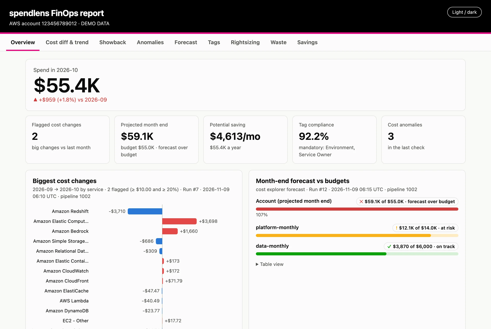
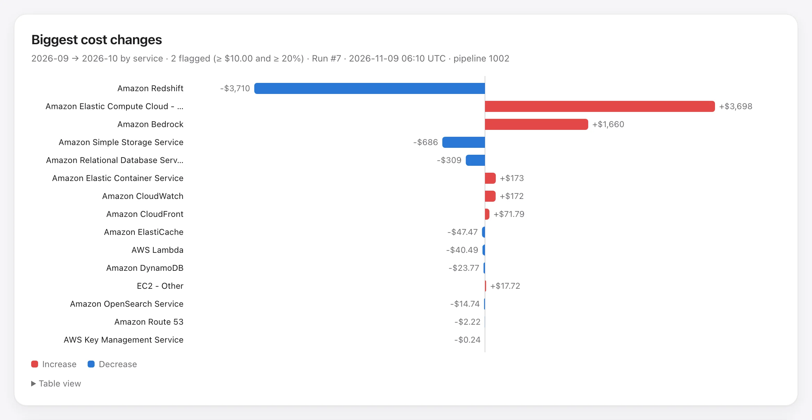
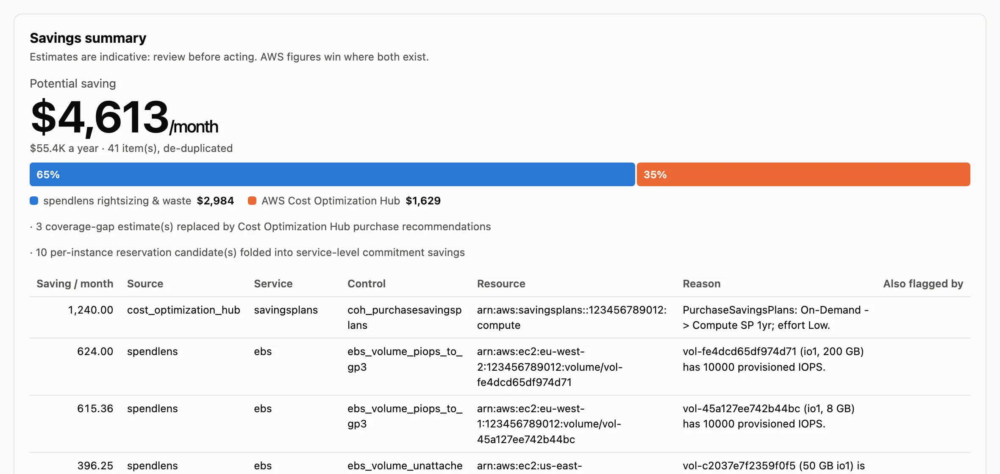
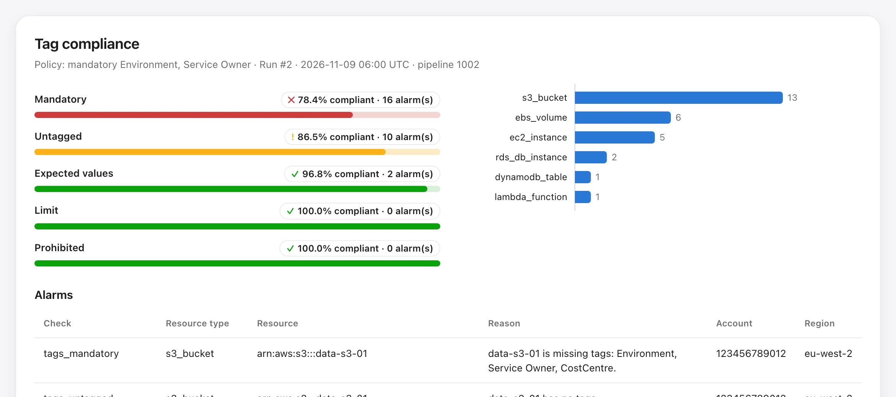
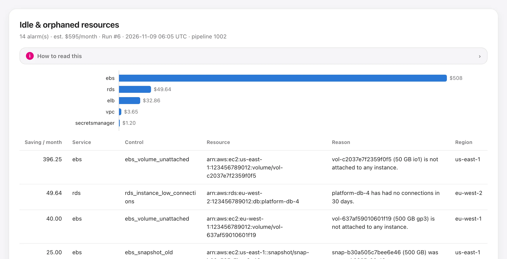
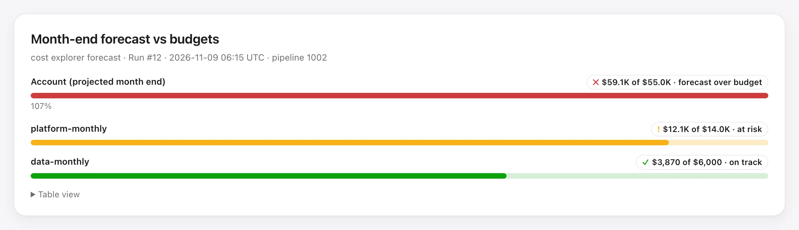
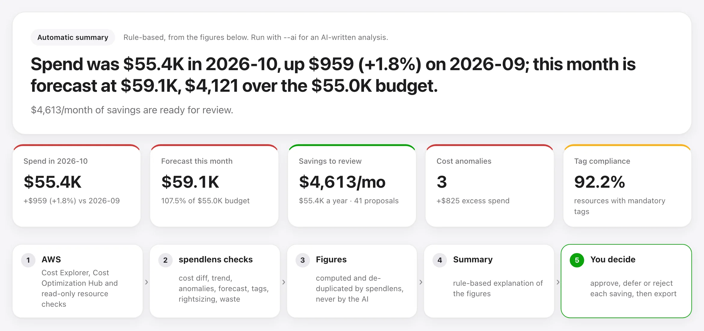
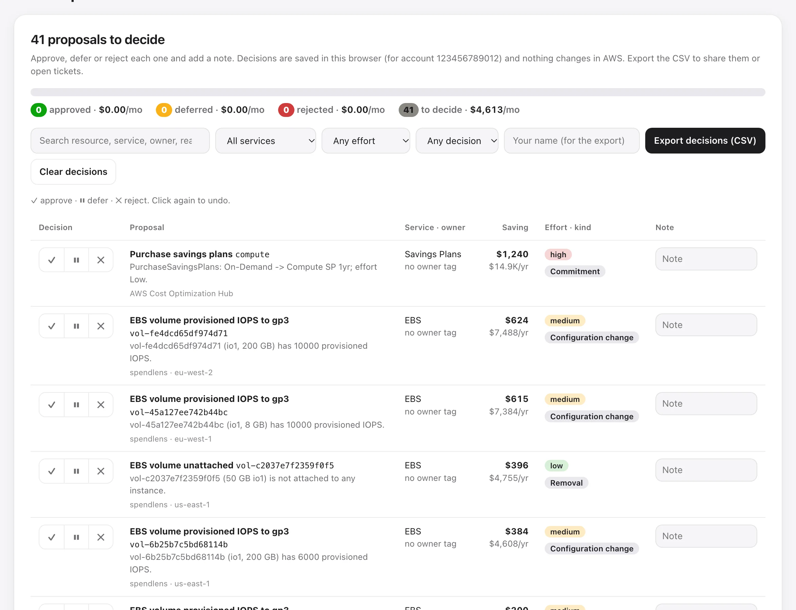
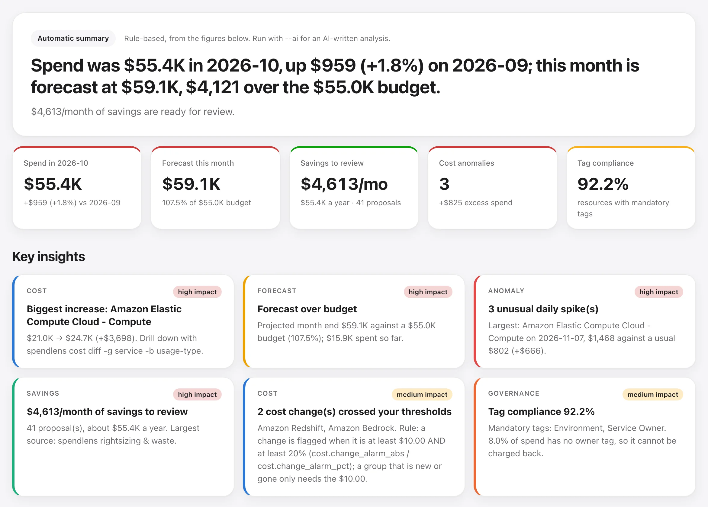

<p align="center">
  
</p>

<h1 align="center">spendlens</h1>

<p align="center"><b>See every dollar. Act on every insight.</b></p>

<p align="center">
  Read-only FinOps for AWS, from your terminal. spendlens finds untagged resources, oversized instances, idle waste
  and unexpected cost spikes, puts a price on each one, and answers your questions in plain English.
</p>

<p align="center">
  <a href="https://github.com/devops-monk/spendlens/actions/workflows/ci.yml"></a>
  <a href="https://hub.docker.com/r/abhaypratap/spendlens"></a>
  
  <a href="LICENSE"></a>
</p>

<p align="center">
  <a href="https://spendlens.devops-monk.com"><b>Website</b></a> ·
  <a href="https://spendlens.devops-monk.com/docs/">Docs</a> ·
  <a href="https://spendlens.devops-monk.com/cheatsheet/">Cheat sheet</a> ·
  <a href="https://spendlens.devops-monk.com/architecture/">Architecture</a> ·
  <a href="https://hub.docker.com/r/abhaypratap/spendlens">Docker Hub</a>
</p>

<p align="center">
  <picture>
    <source media="(prefers-color-scheme: dark)" srcset="website/static/shots/hero-dark.webp">
    
  </picture>
</p>

<p align="center"><sub>One self-contained HTML report, shown with the bundled demo data.</sub></p>

> [!NOTE]
> v0.3.0. spendlens is tested end to end through Steampipe against an AWS emulator. Verification against a live
> account with a read-only role is next (see [PLAN.md](PLAN.md)).

## New in 0.3.0

- **One page for managers.** `spendlens brief -o brief.html` writes an executive report: an analyst summary by the FinOps AI profile, five headline numbers, key insights, monthly spend against the budget, what changed, anomalies with their likely cause, and a checklist of the largest savings to review. spendlens computes every figure; `--no-ai` uses a built-in rule-based summary. [More](#one-page-for-managers)
- **Ask about any AWS table, right first time.** With `--live`, the assistant looks up the real tables, columns and required filters in a catalog built from the Steampipe AWS plugin's source (589 tables), and every query is checked before it reaches AWS. A wrong column comes back with "did you mean".
- **Patient and cached.** Slow live queries run as jobs the assistant waits for. Fresh results are reused (15 min for resources, 5 for metrics, 6 h for Cost Explorer), and the same question on the same data costs no tokens. `--fresh` skips the cache.
- **The assistant's tools, for you.** `spendlens schema find | show | check` searches the catalog and checks a query offline; `spendlens cache show | clear` inspects the cache.
- **`spendlens report` also writes `brief.html`** (rule-based; add `--ai` for the AI summary).
- **The [cheat sheet](https://spendlens.devops-monk.com/cheatsheet/)** now has 148 commands, with a section for schema and cache.

**Heads-up:** the assistant's live tools are renamed (`steampipe_query` is now `aws_query`, plus `aws_find_tables`, `aws_describe_table`, `aws_check_query`, `aws_query_result`), and a live query may now run for up to 5 minutes (`llm.query_timeout_s`, was 60 s). Full notes: [release v0.3.0](https://github.com/devops-monk/spendlens/releases/tag/v0.3.0).

## New in 0.2.0

- **Always fresh, never half-empty.** `dashboard`, `notify` and `savings summary` reuse every check already run today and run the rest first, so they always cover everything. Use `--refresh` to re-run all, or `--source last` for no AWS calls. [More](#always-fresh-never-half-empty)
- **Cost drill-down.** `spendlens cost diff -g service -b tag:Name` shows which resource or app is behind each service's change. `-b` also takes `usage-type`, `region` or any tag; add `-f html` for a searchable report.
- **Reports that explain themselves.** Every dashboard tab and HTML report has a "How to read this" box with your actual thresholds and the setting that changes each one. "Flagged" always states its rule (e.g. at least $10 AND at least 20%).
- **Charted reports for every cost command.** `-f html` on `cost diff`, `trend`, `showback`, `anomalies` and `forecast` gives bar, line and budget charts with the full table.
- **Findings at scale.** `-f html` on `tags`, `rightsize` and `waste` gives an interactive report with filters and search, each check's thresholds, and why each resource alarmed. It handles tens of thousands of results.
- **Live progress, and eu-west-1 by default.** Long runs show the current step and an elapsed timer; set `aws.regions` to query other regions.
- **A [cheat sheet](https://spendlens.devops-monk.com/cheatsheet/)** of 125 ready-to-copy commands, grouped by the question they answer.

**Heads-up:** `dashboard`, `notify` and `savings summary` now call AWS by default when a check hasn't run today. Add `--source last` to keep them offline. Full notes: [release v0.2.0](https://github.com/devops-monk/spendlens/releases/tag/v0.2.0).

---

## Install

**macOS or Linux**: one command, no sudo. Installs pinned Steampipe and Powerpipe, the AWS plugin, and spendlens in
its own isolated environment.

```bash
curl -fsSL https://spendlens.devops-monk.com/install.sh | sh
```

**Docker**: everything included, for amd64 and arm64.

```bash
docker pull abhaypratap/spendlens
docker run --rm abhaypratap/spendlens tags --source demo --summary
```

Run `SPENDLENS_DRY_RUN=1 sh install.sh` to see each installer step without changing anything. To run the image against your account, see [docs/docker.md](docs/docker.md).

## Try it in thirty seconds

Every command replays bundled sample data. You need no AWS account and no credentials:

```bash
spendlens tags --source demo --summary
spendlens waste --source demo --summary --by service
spendlens report --source demo --out demo-report     # open demo-report/report.html
```

Then connect your account:

```bash
spendlens init       # writes finops.yaml: your mandatory tags, allowed instance types, budgets
spendlens doctor     # checks tools, your AWS identity and Cost Explorer access
```

spendlens uses whatever AWS role your terminal already has assumed. It stores no keys.

---

## Know what changed. Before finance asks.

Compare any two months, quarters or date ranges, by service, account, region or any tag. New and removed services
are always shown, and changes that cross your thresholds are flagged, with the rule stated: by default at least $10
**and** at least 20% (`cost.change_alarm_abs` / `cost.change_alarm_pct`).

<picture>
  <source media="(prefers-color-scheme: dark)" srcset="website/static/shots/cost-dark.webp">
  
</picture>

```bash
spendlens cost diff                                   # last full month vs the month before
spendlens cost diff --mtd -g account                  # month to date vs the same days last month
spendlens cost diff --from 2026-07..2026-09 --to 2026-10..2026-12 -g tag:Team
spendlens cost trend -n 6                            # monthly pivot with month-over-month change
spendlens cost showback -t Team                      # spend per team, untagged share called out
spendlens cost diff -g service -b tag:Name           # inside each service: which tagged resources changed
spendlens cost diff -g usage-type --top 15           # what inside the services changed (logs? storage? transfer?)
spendlens cost diff -f html -o cost-diff.html        # charted report: tiles, flagged list, change and spend charts
```

## One number. Every dollar explained.

spendlens's own rightsizing and waste findings are merged with AWS Cost Optimization Hub and Savings Plan coverage.
Each resource counts once, AWS's figure wins where both exist, and every adjustment is listed.

<picture>
  <source media="(prefers-color-scheme: dark)" srcset="website/static/shots/savings-dark.webp">
  
</picture>

```bash
spendlens savings summary          # one de-duplicated total (reuses today's checks, runs the rest)
spendlens savings summary --refresh  # re-check all four sources now
spendlens savings hub              # AWS Cost Optimization Hub recommendations
spendlens savings commitments      # Savings Plan and RI coverage, expiring plans
```

## Every dollar, owned.

Mandatory, untagged, prohibited, tag-limit and allowed-value checks run across 70 resource types and show the exact
tags each resource is missing. Showback by team calls out the untagged share.

<picture>
  <source media="(prefers-color-scheme: dark)" srcset="website/static/shots/tags-dark.webp">
  
</picture>

```bash
spendlens tags --summary
spendlens tags -k mandatory -r s3_bucket -r ec2_instance
spendlens tags --fail-on-alarm         # exit 3 on any alarm: a CI gate
```

## Stop paying for nothing.

65 rightsizing and waste controls cover unattached volumes, orphaned snapshots, idle load balancers and NAT gateways,
gp2 volumes that should be gp3, previous-generation instances, and Multi-AZ outside prod. Each comes with a monthly
dollar estimate.

<picture>
  <source media="(prefers-color-scheme: dark)" srcset="website/static/shots/waste-dark.webp">
  
</picture>

```bash
spendlens waste --summary --by service
spendlens rightsize -S ec2 -S rds --min-saving 50
spendlens rightsize --set sizing.ec2_cpu_low=10        # any threshold, for one run
```

The full catalog is in [docs/controls.md](docs/controls.md), and the mapping from the legacy mods is in [docs/control-mapping.md](docs/control-mapping.md).

## Month-end, without surprises.

Daily spikes are measured against a robust 30-day baseline. The projected month end is checked against your budget
and against every AWS Budget.

<picture>
  <source media="(prefers-color-scheme: dark)" srcset="website/static/shots/forecast-dark.webp">
  
</picture>

```bash
spendlens anomalies --fail-on-anomaly
spendlens forecast --fail-on-risk
```

## One command. The whole review.

```bash
spendlens review -o review.html
```

The FinOps AI analyst explains your AWS spend, flags the anomalies and lays out every saving. Then you decide what happens to each one. One printable HTML page:
- **Spend, explained:** monthly spend against the budget, a bridge from last month's total through each big change to this month's, the trend of the top services, a service → workload flow, spend by owner, and every service in a table.
- **Anomalies:** usual vs actual for each spike, with its severity and likely cause.
- **Savings, mapped:** the total by source and service, an effort × value matrix, whether each change is reversible, a removal or a commitment, and a flow from the check that found it to the service it saves on.
- **For human review:** approve, defer or reject every proposal with a note, watch the approved total update, and export the decisions as CSV. Decisions stay in your browser; nothing changes in AWS.



spendlens computes every number; the AI only writes the words (`--no-ai` uses a built-in rule-based summary). It shares one cached analysis with `spendlens brief`, so running both asks the AI once. `spendlens report` writes `review.html` too.



## One page for managers.

```bash
spendlens brief -o brief.html
```

The dashboard has every detail. The brief is the page you send to a manager: an analyst summary written by the FinOps AI profile, five headline numbers, key insights ranked by impact, monthly spend against the budget, what changed, anomalies with their likely cause, and a checklist of the largest savings to review. One printable HTML file.



- **Numbers you can trust:** spendlens computes every figure; the AI only writes the words, from those figures and read-only queries on your saved history.
- **No AI? Still a brief:** `--no-ai` (or an AI that's not set up) uses a built-in rule-based summary, and nothing is sent anywhere.
- **In CI:** `spendlens report` writes `reports/brief.html` too; add `--ai` for the AI summary.

## Ask anything. Get answers from your data.

```text
$ spendlens ask "Why did our bill go up last month?" --show-tools
› history_overview · 14 saved runs
› history_query    · cost_diff run #7 · read-only

Spend rose +$959 (+1.8%) to $55.4K in October.
  · EC2 grew +$3,698 (+17.6%)
  · Amazon Bedrock grew +$1,660 (+692%)
  · Redshift was decommissioned: −$3,710
Bedrock and Redshift crossed your alert thresholds.
Source: cost_diff run #7, 2026-11-09
```
<sub>An illustrative answer, using the figures in the bundled demo data.</sub>

Supported models:
- **Claude** on Amazon Bedrock with your own AWS role, or on the Anthropic API (official Anthropic SDK).
- **OpenAI, Azure OpenAI** or any **OpenAI-compatible** server (official OpenAI SDK).

The assistant answers from saved history first, which is offline and free. It queries live AWS only with `--live`, and then it can answer from any of the AWS plugin's 589 tables:
- **Right first time:** it looks up the real tables, columns and required filters in a catalog built from the Steampipe AWS plugin's own source, and every query is checked before it reaches AWS. A wrong column comes back with "did you mean".
- **Patient:** slow queries run as background jobs that the model waits for, instead of timing out.
- **Cached:** live results are reused while fresh (15 min for resources, 5 for metrics, 6 h for Cost Explorer), and the same question on the same data costs no tokens. `--fresh` skips the cache.

Configure it with `llm.*` in `finops.yaml`. See [the AI assistant guide](https://spendlens.devops-monk.com/docs/ai-assistant/).

### The assistant's tools, for you

The table search, table description and query checker the assistant uses also work as commands. They run offline from the bundled catalog: no AWS calls, no Steampipe and no AI provider.

```bash
spendlens schema find "unattached EBS volumes"          # which tables answer this? (-n 3, --json)
spendlens schema show aws_cost_usage                    # columns, required filters, fast filters, examples
spendlens schema check "select volume_id, size_gb from aws_ebs_volume"
```

```text
✗ column size_gb does not exist in aws_ebs_volume
  did you mean: size
```

`schema check` exits with 1 when a query would fail: an unknown table or column, a missing required filter, or a JSON operator on a text column. It warns when a Cost Explorer query has no date range, a metric query has no time range, or a wide table is read with `select *`. Use it in scripts and CI to catch mistakes before your queries reach AWS.

### The cache

Live results, answers and brief summaries are kept in `ai-cache.db`, next to the history database. Each kind is reused only while fresh, and only for the same Steampipe connection, regions and AWS identity.

```bash
spendlens cache show --entries     # what's cached, how old it is, when it expires
spendlens cache clear --queries    # forget live results; --answers for answers and brief summaries
spendlens cache clear              # everything
spendlens ask --live --fresh "How many instances are running right now?"   # skip the cache once
```

Tune the freshness, or turn the cache off, with `llm.cache.*` in `finops.yaml` (see [Cache commands](https://spendlens.devops-monk.com/docs/ai-assistant/#cache-commands)).

## Scheduled. Notified. Hands-off.

```bash
spendlens report --out reports                     # every check, plus reports/report.html
spendlens notify --slack --teams --only-if-changes # a summary, only when something needs attention
spendlens init --ci gitlab                         # or --ci github: a scheduled pipeline on a read-only OIDC role
```

- **`report`:** if one step fails, for example because of a missing permission, the others still run and write their output.
- **`notify`:** reads webhook URLs only from `$SPENDLENS_SLACK_WEBHOOK` and `$SPENDLENS_TEAMS_WEBHOOK`.
- **CI templates:** keep the run history between pipelines.

### Always fresh, never half-empty

`dashboard`, `notify` and `savings summary` combine many checks. By default they reuse every check already run **today** and run the rest live first, so the result covers everything and is at most a day old. A check run by one of them is reused by the others later that day.

```bash
# Default: reuse today's checks, run the rest
spendlens dashboard -o report.html
spendlens notify --slack
spendlens savings summary

# Re-run everything now, e.g. after a deployment or clean-up
spendlens dashboard --refresh -o report.html
spendlens notify --slack --refresh
spendlens savings summary --refresh

# Saved runs only, no AWS calls (e.g. in CI right after spendlens report)
spendlens dashboard --source last -o report.html
spendlens notify --slack --source last
spendlens savings summary --source last
```

If a check can't run, for example because of a missing permission, the output says why and uses that check's last saved run.

Setup is in [docs/ci.md](docs/ci.md).

---

## Read-only. By design.

spendlens never creates, changes, tags or deletes anything. Savings are proposals for a person to review. The
[IAM permissions](docs/permissions.md) page lists the read-only actions each feature needs.

Every query the AI assistant writes goes through three safety layers:
1. **SQL guard.** The query is parsed with sqlglot, and only a single read-only `SELECT` passes.
2. **Read-only history.** SQLite opens with `mode=ro` and `query_only`, and an authorizer denies everything except reads.
3. **Read-only sessions.** With `--live`, Steampipe sessions run with `default_transaction_read_only`, a timeout and a row cap.

## Your standards, in one file

Every threshold and policy is a typed parameter. Later layers override earlier ones:

| Layer | Example |
|---|---|
| Built-in defaults | n/a |
| `finops.yaml` | `sizing: {ec2_cpu_low: 15}` |
| Environment | `SPENDLENS__SIZING__EC2_CPU_LOW=12` |
| Command line | `--set sizing.ec2_cpu_low=10`  ·  `--set 'tagging.mandatory=[Env, Owner]'` |

Run `spendlens params --filter ec2` to see every value, where it came from, and its environment-variable name.
Unknown keys, typos and out-of-range values are rejected, and the error names the layer they came from.

## Commands at a glance

| Command | What it does |
|---|---|
| `tags` | Tag compliance across 70 resource types |
| `rightsize` · `waste` | 65 controls with $/month estimates |
| `cost diff` · `trend` · `showback` · `resources` | What changed, where, and who owns it |
| `anomalies` · `forecast` | Daily spikes; month-end projection against budgets |
| `savings hub` · `commitments` · `summary` | AWS recommendations, coverage, one de-duplicated total (`summary --refresh`: re-check now) |
| `dashboard` | A self-contained HTML report with nine tabs, always covering every check (`--refresh`: re-run all now) |
| `review` | The whole review in one page: AI analysis, spend bridge and flows, anomalies, savings, and a queue to approve, defer or reject each saving (CSV export) |
| `brief` | One page for managers: AI summary, key numbers, charts and a savings review checklist |
| `ask` | Questions in plain English, read-only (`--live`: any AWS table, schema-checked and cached) |
| `schema find` · `show` · `check` | Find the AWS table for a question, read its columns and filters, check a query before it runs (offline) |
| `cache show` · `clear` | What the AI assistant has cached and when it expires; forget it |
| `report` · `notify` | Run everything; post Slack or Teams summaries (`notify --refresh`: re-check first) |
| `history list` · `diff` | Saved runs, and new or resolved alarms between them |
| `init` · `doctor` · `params` · `config` | Set up, check, and inspect configuration |

Every report command accepts:
- `--format table|csv|json|html` and `--out FILE`;
- `--source live|last|demo`.

`--source last` replays your latest saved run offline. `dashboard`, `notify` and `savings summary` also accept `--refresh` (see [Always fresh](#always-fresh-never-half-empty)). The full reference is the [CLI reference](https://spendlens.devops-monk.com/docs/cli/).

## Extending

spendlens's own features are plugins. A package can add commands, Powerpipe controls, savings estimators, AI tools,
doctor checks and dashboard tabs:

```toml
[project.entry-points."spendlens.plugins"]
acme = "acme_spendlens"
```

```python
def register(reg):
    reg.add_typer(my_typer_app, "acme")        # spendlens acme ...
    reg.add_mod(Path(__file__).parent / "mod")
    reg.add_doctor_check(check_fn)
```

See [Extending](https://spendlens.devops-monk.com/docs/extending/) for the full API.

## Development

```bash
git clone https://github.com/devops-monk/spendlens.git && cd spendlens
python3 -m venv .venv && .venv/bin/pip install -e ".[dev]"
make test              # unit + integration (fast, no cloud)
make test-system       # end to end against the Moto AWS emulator through an isolated Steampipe
make lint
make generate          # after changing the config schema, tag catalog, controls or demo data
```

CI runs on every push: lint, tests on Python 3.11 and 3.13, a website check, and an offline Docker smoke test.

## License

spendlens is licensed under the [Apache License 2.0](LICENSE). Some controls are adapted from Turbot's Apache-2.0
Powerpipe mods. The Docker image includes Steampipe and Powerpipe (AGPL-3.0, unmodified); see [NOTICE](NOTICE).
